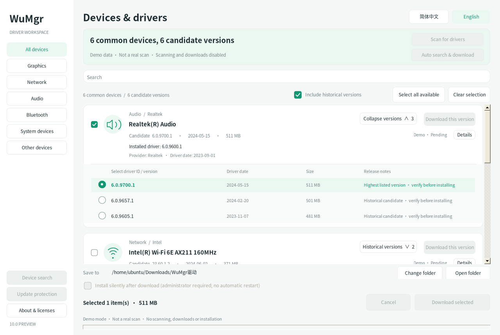
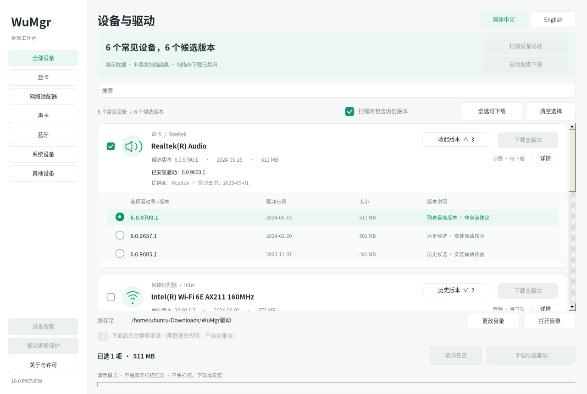
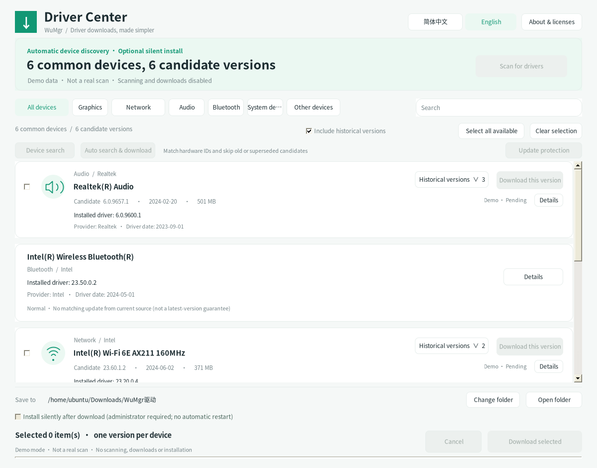

## WPF Preview 2 (alongside WinForms)

[Download the complete WPF Preview 2 package](https://github.com/AMDSE/wumgr/releases/tag/wpf-preview-2) · [English WPF guide](wpf/preview-2/README-WPF.en.md) · [中文指南](wpf/preview-2/README-WPF.zh-CN.md) · [Separate source](wpf/preview-2) · [SHA-256](SHA256SUMS-WPF-preview-2.txt)

A new interface using XAML, native WPF controls and an MVVM coordinator, sharing the V10 driver core—not embedded WinForms or a web page. This is a **separate prerelease**. The existing [WinForms V10 preview](https://github.com/AMDSE/wumgr/releases/tag/v10.0.0-preview), `src/` source, historical packages and releases remain intact; **v8.0.0 remains the Latest stable release**. Corresponding WPF source, build/test scripts and licenses live separately in `wpf/preview-2/`; the complete ZIP also includes the application and Windows acceptance tools. The existing interface screenshots below show WinForms, not a running WPF application.

### Running WPF

On Windows 10/11, fully extract `WuMgr-WPF-preview-2.zip` and run **`程序\WuMgr.exe`**, keeping the adjacent DLLs and configuration. The native launcher checks for .NET Framework 4.8+; an existing runtime starts directly and no .NET SDK is required. When missing, it downloads Microsoft's official offline installer over HTTPS (~116 MiB, not bundled), verifies the pinned SHA-256, Authenticode trust and Microsoft signer, and only then requests UAC approval to install it. Reboot-required results ask for a manual reboot; no automatic restart occurs. Automatic provisioning supports Windows 10 1607+ / Windows 11 x86/x64; it does not install a missing runtime on ARM64. See the [runtime provisioning notes (Chinese)](wpf/preview-2/RUNTIME-BOOTSTRAP.zh-CN.md).

From the `程序` directory, preview synthetic data first:

```powershell
.\WuMgr.exe --demo --lang zh-CN
.\WuMgr.exe --demo --lang en-US
```

Demo mode disables real device scanning, WUA, downloads, installation and policy operations. Normal startup only reads devices and protection policy; **Scan updates** explicitly queries WUA, and download-only is the default. Driver installation or policy writes require manually reopening WPF as administrator and reviewing specific confirmations. WPF does not automatically elevate or restart (the launcher's UAC request for a missing runtime is a separate exception). The application is unsigned; do not disable system protection to bypass warnings.

### Preview and Windows validation limits

.NET Framework 4.8 cross-compilation and **82 controlled-backend logic assertions** are complete; these are not Windows acceptance results. This Linux build environment has not validated real WPF rendering, first-run runtime installation/UAC/reboot, SetupAPI/WMI device enumeration, WUA scanning/installation, effective protection policy, high DPI, multiple monitors or accessibility. Precompiled safe demo acceptance tools are included at `验收工具\运行安全验收.cmd` and need no SDK, but were **not executed on Windows for this delivery**. No fabricated PASS results or WPF runtime screenshots are supplied. Use a recoverable Windows test machine/VM for initial driver-installation and policy-write tests.

Building requires .NET SDK 8+ and an x86 MinGW-w64 toolchain providing `i686-w64-mingw32-gcc`. From `wpf/preview-2/`, run `build-wpf.ps1`, then `test-wpf-windows.ps1`; output is `dist/WuMgr-WPF`. The application runtime remains .NET Framework 4.8, not .NET 8 Desktop Runtime.

---

> **v10 Preview — clean rounded controls and modern checkboxes.** Removes rectangular corner surfaces/native outer borders, refreshes checkbox and history radio styling while keeping native keyboard and selection behavior. Published as a GitHub prerelease. Windows/high-DPI acceptance pending. See [v10 notes](更新说明-v10-preview.md).

> **v9 Preview — UI refresh and staged modernization.** Sidebar categories, responsive command area, Ctrl+F / Escape / F5, cached hardware inventory for filtering, and reduced repeated URL / hardware-ID work. Still native WinForms + .NET Framework 4.8. Linux/Mono regression tests only; Windows and high-DPI acceptance pending. This local preview does not replace the published v8 release. See [v9 preview notes](更新说明-v9-preview.md).

> v8: the main list shows common detected hardware and installed driver version/provider/date even without updates. Virtual devices, endpoint noise and duplicate CPU cores are hidden here; Device search retains the full inventory. Windows hardware acceptance is pending.

# WuMgr Driver Download Center · v8

**Find device drivers, choose historical candidates, download in parallel, and optionally install silently. Now with instant Simplified Chinese / English switching.**

[简体中文](README.md) · [Download v8](WuMgr-驱动下载中心-v8.zip) · [Detailed Chinese guide](README.zh-CN.md)

This is an independent modification of [DavidXanatos/wumgr](https://github.com/DavidXanatos/wumgr), **not an official upstream release**. The current executable opens the driver center; it does not include the upstream legacy full Windows update-management UI.

## Running interface

These are captures of the actual WinForms application running under Linux / Mono with **demonstration data**, not real-device scan results or Windows acceptance screenshots. Fonts, borders and scaling may differ on Windows. Real scanning, downloads, installation and policy changes are disabled in demo mode.

### English



### 简体中文





## Features

- Discover local devices and search by model, vendor, hardware ID or driver version. The device-search dialog shows exact hardware/compatible-ID matches.
- Group candidates by device and choose historical versions. Only candidates returned by the current Windows update source are shown; complete history is not guaranteed. The highest listed version is not an installation recommendation.
- Automatically select matching drivers, skipping older, unknown-version, superseded and missing-URL candidates, then ask before downloading.
- Download through pinned Downloader 3.1.2: up to 8 blocks and 4 concurrent requests per file, with speed and progress. Small files and servers without Range use one stream.
- Download only by default. Optional WUA-based silent installation and reversible system-wide driver-update protection require explicit user action.
- Switch Simplified Chinese / English from the header without restarting; keep current selections and remember the language preference.

## Download and run

1. [Download the complete v8 ZIP](WuMgr-驱动下载中心-v8.zip) and extract it fully.
2. On **Windows 10 / 11**, open `程序\wumgr.exe`. **.NET Framework 4.8**, Windows Update services and network access are required.
3. Scan for drivers, verify the model and version, choose a folder, and download. Use device search to inspect exact matches.
4. Only if installation is intended, run as administrator, explicitly enable silent installation, and review the confirmation. The app does not auto-elevate or restart the computer, and protection is off by default.

The package includes the executable, corresponding source, bilingual documentation, previews, test output and SHA-256 manifest. The [v5 package](WuMgr-驱动下载中心-v5.zip) remains available for rollback.

## Language switching

Use the header selector: **简体中文 / English**. It updates the app-owned UI, driver cards, device search, details, policy explanations and operation prompts. Device names, hardware IDs, vendor text and original Windows error details are not translated.

The first launch defaults to Simplified Chinese. Subsequent launches use the saved local preference. A command-line option overrides the language for the current launch:

```bat
wumgr.exe --lang zh-CN
wumgr.exe --lang en-US
wumgr.exe --demo --lang en-US
wumgr.exe --preview preview-en.png --lang en-US
```

Changing language in the UI saves the preference. Preview mode uses safe demo data and does not change saved preferences.

## Safety and limitations

**HTTP downloads and system installation are separate.** Installation uses the [Windows Update Agent API](https://learn.microsoft.com/en-us/windows/win32/wua_sdk/portal-client) and its system cache, so WUA may download files again. The application does not execute EXE, script or CAB files from the download folder or bypass Windows signature checks. Driver installation may briefly disconnect networking, flicker the display or require a manual reboot. Canceling does not roll back completed installations.

**Resume is conditional.** Cancellation/failure preserves `.part` and `.resume.xml` files. Resuming the same URL into the same folder requires Range support and a valid strong ETag or Last-Modified validator. Changed resources or missing validators cause a fresh download. Crash recovery is not guaranteed.

**Protection is limited.** The Microsoft [ExcludeWUDriversInQualityUpdate policy](https://learn.microsoft.com/en-us/windows/client-management/mdm/policy-csp-update#excludewudriversinqualityupdate) excludes drivers from routine quality updates without disabling security updates. It does not guarantee blocking feature-update drivers, manual changes or vendor tools. It applies system-wide, can be overridden by organizational policy, and is not promised to work on Home editions. Relevant original values are backed up for restoration.

**Validation covers Linux / Mono automated tests and demo rendering only.** Real Windows WMI/WUA, Microsoft CDN downloads, elevation and effective policy behavior still require on-device acceptance testing. See the [Windows checklist](tests/Windows验收清单.md) and [v8 test log](最终测试日志-v8.txt).

## Build and test

On Windows, install Visual Studio 2022 with the .NET desktop workload and .NET Framework 4.8 targeting pack, then run:

```bat
build-windows.cmd
```

The script restores pinned Downloader 3.1.2 with NuGet CLI if needed. On Linux / Mono, for tests and demo rendering only:

```bash
bash tests/run-tests.sh
python3 package-release.py
```

The entry point is `wumgr/DriverProgram.cs`; tests are in `tests/`. Packaging excludes NuGet caches, generated `bin/obj` directories and test executables from the source tree.

## License and attribution

Released under [GNU GPLv3](LICENSE), without warranty. Original project copyright belongs to DavidXanatos. [Downloader 3.1.2](https://github.com/bezzad/Downloader/tree/v3.1.2) is MIT-licensed; attribution is included in [third-party/Downloader](third-party/Downloader/README.md) and the release. Existing Icons8 attribution and licensing are retained. The previous root Apache 2.0 template is preserved for historical reference; see [licensing notes](docs/licensing/README.md). See [privacy policy](PRIVACY_POLICY.md).
