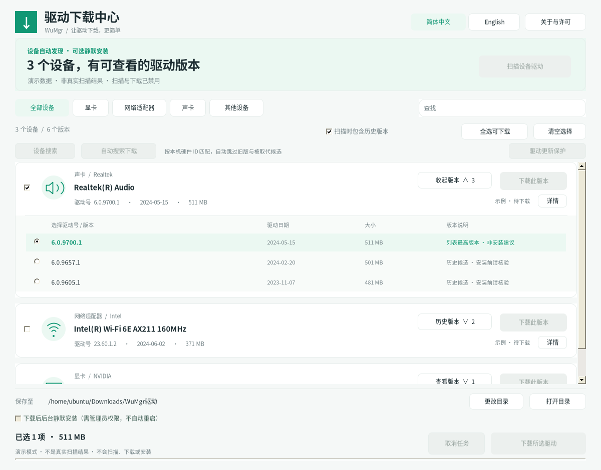

> v7 修复设备枚举与重复驱动：新增原生 SetupAPI 清单，设备不再因无更新而消失；蓝牙/系统设备独立分类，同包候选去重并保留真实历史版本。Linux/Mono 下 181 项自动化测试全部通过，Windows 实机验收仍待完成。[更新说明](更新说明-v7.md)。

# WuMgr 驱动下载中心 · v7

**设备驱动搜索、历史候选选择、多线程下载，以及可选的静默安装。现在支持简体中文 / English 即时切换。**

[English](README.en.md) · [中文详细说明](README.zh-CN.md) · [下载 v7 完整包](WuMgr-驱动下载中心-v7.zip) · [v7 更新说明](更新说明-v7.md)

这是基于 [DavidXanatos/wumgr](https://github.com/DavidXanatos/wumgr) 的独立修改版，**不是上游官方发布**。当前可执行程序以驱动下载中心为入口，不包含上游旧版完整 Windows 更新管理界面。

## 运行界面预览

以下图片由本项目实际 WinForms 程序在 Linux / Mono 下运行并截取，**使用演示数据，不是真实设备扫描结果，也不是 Windows 实机验收截图**。Windows 的字体、窗口边框及缩放效果可能不同。演示模式禁止真实扫描、下载、安装和策略修改。

### 简体中文



### English


## 能做什么

- **查设备、找驱动**：读取本机设备，按设备名、厂商、硬件 ID 或驱动版本搜索；设备搜索窗口展示硬件 ID / 兼容 ID 精确匹配的候选。
- **查看历史候选**：同一设备按版本归组，可展开、选择并下载。仅展示当前 Windows 更新源返回的适用候选，不保证完整版本历史；列表最高版本不等于安装建议。
- **自动匹配下载**：跳过旧版、版本未知、无地址及被取代候选，开始前展示确认。
- **多线程下载**：Downloader 3.1.2，每个文件最多 8 分块、4 并发请求，显示进度与速度；小文件或不支持 Range 时改用单流。
- **按需安装和保护**：默认仅下载。用户主动勾选并确认后，可通过 WUA 后台静默安装；可选择启用可恢复的全机驱动更新保护。
- **双语界面**：顶栏选择「简体中文 / English」，无需重启，保留当前操作选择并记住语言偏好。

## 下载与运行

1. [下载 `WuMgr-驱动下载中心-v7.zip`](WuMgr-驱动下载中心-v7.zip)，完整解压，不要直接在压缩包内运行。
2. 在 **Windows 10 / 11** 打开 `程序\wumgr.exe`；需要 **.NET Framework 4.8**、Windows 更新服务与网络。
3. 点击「扫描设备驱动」，核对设备型号和版本，选择保存目录后下载。也可以进入「设备搜索」查看精确匹配。
4. 若确需安装，先右键「以管理员身份运行」，勾选「下载后后台静默安装」并阅读确认提示。程序不自动提权、不自动重启，默认也不开启更新保护。


## 中英文切换

顶栏语言选择器即时切换主窗口、版本卡片、设备搜索、详情、保护说明与操作提示。设备型号、硬件 ID、厂商名称，以及 Windows 返回的原始错误信息保持原文。

首次默认简体中文，之后使用本地保存的语言偏好。也可通过命令行指定本次启动的语言：

```bat
wumgr.exe --lang zh-CN
wumgr.exe --lang en-US
wumgr.exe --demo --lang en-US
wumgr.exe --preview preview-en.png --lang en-US
```

`--demo` 与 `--preview` 使用安全演示数据；命令行语言用于本次启动。界面内手动选择会保存偏好。截图模式不修改用户偏好。

## 安全边界与已知限制

**下载不等于安装。** 多线程 HTTP 下载独立于 [Windows Update Agent（WUA）](https://learn.microsoft.com/en-us/windows/win32/wua_sdk/portal-client) 的系统安装缓存；安装时 WUA 可能再次下载。程序不会直接执行下载目录中的 EXE、脚本或 CAB，不绕过系统签名检查；安装可能短暂断网、闪屏或需要手动重启。取消不会回滚已经完成的安装。

**续传有条件。** 取消或失败后保留 `.part` 与 `.resume.xml`；相同 URL、相同目录，且服务器支持 Range 并提供有效强 ETag 或 Last-Modified 时可尝试恢复。资源改变或缺少校验标识则重新下载，不承诺进程崩溃后续传。

**保护不是全面拦截。** 使用微软 [ExcludeWUDriversInQualityUpdate 策略](https://learn.microsoft.com/en-us/windows/client-management/mdm/policy-csp-update#excludewudriversinqualityupdate)，仅排除常规质量更新中的驱动，不关闭安全更新；不能保证拦截功能更新、手动安装或厂商工具。全机生效，组织策略可能覆盖，家庭版不承诺生效。开启前备份相关原值，可通过界面恢复。

**验证范围：Linux / Mono 自动化测试与演示截图；Windows 真实 WMI、WUA、微软 CDN、管理员权限和策略生效仍待实机验收。** 不应据此把程序视为已完成 Windows 生产环境验证。参见 [Windows 验收清单](Windows验收清单.md) 和 [测试日志](最终测试日志-v7.txt)。

## 构建与测试

Windows：安装 Visual Studio 2022「.NET 桌面开发」及 .NET Framework 4.8 目标包，在源码根目录执行：

```bat
build-windows.cmd
```

脚本在缺包时通过 NuGet CLI 还原固定的 Downloader 3.1.2。Linux / Mono 仅用于测试与演示：

```bash
bash tests/run-tests.sh
python3 package-release.py
```

完整包的 `源码/` 中含 `wumgr/` 与 `tests/`；入口为 `DriverProgram.cs`，构建与测试命令均在包内源码目录执行。打包脚本不会把 NuGet 缓存、`bin/obj` 或测试 EXE 混入源码。

## 许可与来源

本项目依据 [GNU GPLv3](LICENSE) 发布，无任何担保。上游版权归 DavidXanatos；下载组件 [Downloader 3.1.2](https://github.com/bezzad/Downloader/tree/v3.1.2) 使用 MIT 许可，见 [第三方说明](Downloader-归属说明.md)。图标来源 Icons8，保留原有归属与许可。原仓库根目录 Apache 2.0 模板与包内 GPLv3 不一致，已原样备份并写明 [许可历史与适用范围](许可说明.md)。更多数据处理说明见 [隐私政策](PRIVACY_POLICY.md)。
