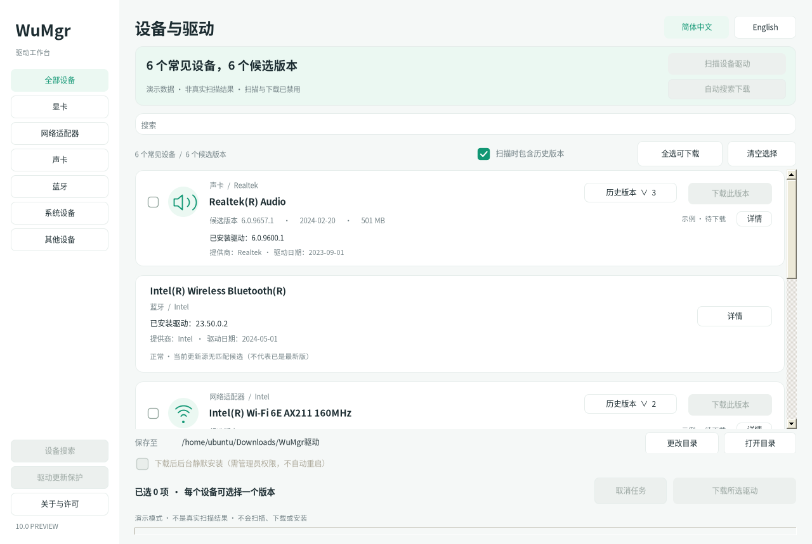

## WPF Preview 2（与 WinForms 并存）

[下载 WPF Preview 2 完整包](https://github.com/AMDSE/wumgr/releases/tag/wpf-preview-2) · [WPF 中文指南](wpf/preview-2/README-WPF.zh-CN.md) · [English guide](wpf/preview-2/README-WPF.en.md) · [独立源码](wpf/preview-2) · [SHA-256](SHA256SUMS-WPF-preview-2.txt)

这是使用 XAML、原生 WPF 控件和 MVVM 协调层的新界面，共享 V10 驱动业务核心，不是嵌入 WinForms 或网页。它作为**独立预览版**发布；现有 [WinForms V10 预览版](https://github.com/AMDSE/wumgr/releases/tag/v10.0.0-preview)、`src/` 源码、历史包和 Release 均保留，**v8.0.0 继续作为 Latest 稳定版**。WPF 对应源码、构建/测试脚本及许可证单独放在 `wpf/preview-2/`，完整 ZIP 还含程序和 Windows 验收工具。下方原有界面截图属于 WinForms，不是 WPF 运行截图。

### WPF 如何运行

在 Windows 10/11 上完整解压 `WuMgr-WPF-preview-2.zip`，运行 **`程序\WuMgr.exe`**，保留同目录 DLL 和配置。原生启动器检查 .NET Framework 4.8+；已有环境直接启动，不需要 .NET SDK。缺少时通过 HTTPS 下载微软官方离线安装包（约 116 MiB，不随 ZIP 捆绑），校验固定 SHA-256、Authenticode 信任及微软签名者后，才请求 UAC 授权安装。需要重启时仅提示手动重启，不自动重启。自动补装范围是 Windows 10 1607+ / Windows 11 的 x86/x64；ARM64 缺环境时不自动补装。详见[运行环境说明](wpf/preview-2/RUNTIME-BOOTSTRAP.zh-CN.md)。

在 `程序` 目录可先用演示数据查看界面：

```powershell
.\WuMgr.exe --demo --lang zh-CN
.\WuMgr.exe --demo --lang en-US
```

演示模式禁用真实设备扫描、WUA、下载、安装和策略操作。正常启动只读取设备与保护策略；点击“扫描更新”才查询 WUA，默认仅下载。驱动安装或策略写入需自行以管理员身份重新打开 WPF，并逐项确认；WPF 不自动提权、不自动重启（缺环境时启动器安装运行环境的 UAC 请求除外）。程序未签名，不建议关闭系统防护绕过警告。

### 预览与 Windows 实测限制

已完成 .NET Framework 4.8 交叉编译和 **82 项可控后台逻辑断言**；这些不等于 Windows 实机通过。当前 Linux 构建环境没有验证真实 WPF 渲染、首次运行环境补装/UAC/重启、SetupAPI/WMI 设备枚举、WUA 扫描与安装、保护策略生效、高 DPI、多屏及辅助功能。`验收工具\运行安全验收.cmd` 提供已编译的安全演示验收工具，无需 SDK，但本次**尚未在 Windows 执行**；没有伪造 PASS 或 WPF 运行截图。首次驱动安装与策略写入请在可恢复的 Windows 测试机/虚拟机完成。

源码构建需 .NET SDK 8+ 与提供 `i686-w64-mingw32-gcc` 的 x86 MinGW-w64；在 `wpf/preview-2/` 执行 `build-wpf.ps1`，再执行 `test-wpf-windows.ps1`，输出为 `dist/WuMgr-WPF`。应用运行时仍是 .NET Framework 4.8，而非 .NET 8 Desktop Runtime。

---

> **v10 预览版：圆角去方框、现代复选框。** 修复控件圆角外的矩形底色与原生外框，统一绿色圆角复选框和历史版本单选框，保留原生键盘/选择语义。已发布为 GitHub 预览版，Windows 实机及高 DPI 验收待完成。详见 [v10 说明](更新说明-v10-preview.md)。

> **v9 预览版：界面重构与渐进优化。** 新增侧栏分类、自适应操作区、Ctrl+F / Escape / F5；筛选复用已匹配快照，减少 URL 和硬件 ID 重复处理。保留原生 WinForms + .NET Framework 4.8，尚待 Windows 实机及高 DPI 验收。本地预览不替换已发布 v8，详见[预览版说明](更新说明-v9-preview.md)。下方 v8 功能与安全边界继续适用。

> v8：主界面列出常见硬件及已安装驱动版本、提供商、日期，没有更新也保留；过滤虚拟设备、音频端点、系统杂项和重复逻辑核心。完整原始清单仍在“设备搜索”。详见 [更新说明-v8](更新说明-v8.md)。Windows 实机验收待完成。

# WuMgr 驱动下载中心 · 中英文版 v8

基于 [DavidXanatos/wumgr](https://github.com/DavidXanatos/wumgr) 的独立修改版，不是上游官方发布。当前以驱动中心为入口，不包含上游旧版完整更新管理界面。支持中英文界面、驱动型号／版本、历史候选选择与下载、设备自动发现、匹配下载、可选后台静默安装和驱动更新保护。

[项目首页与双语运行截图](README.md) · [English](README.en.md) · [下载 v8](WuMgr-驱动下载中心-v8.zip)

## 中英文切换

顶栏选择「简体中文 / English」即时切换，无需重启；保留搜索、分类、勾选、历史版本选择、保存目录及静默安装选项。首次默认简体中文，界面手动切换后保存语言偏好。命令行 `--lang zh-CN` / `--lang en-US` 可指定本次启动语言，例如 `wumgr.exe --demo --lang en-US`。设备型号、厂商原文与系统原始错误不翻译。

运行截图来自真实程序的 Linux / Mono 演示模式，不是真实设备扫描或 Windows 实机验收截图；Windows 字体与缩放可能不同。`--preview preview.png --lang en-US` 可以自行生成安全演示截图，不更改语言偏好。

## 如何使用

在 Windows 10 / 11 解压后运行 `程序\wumgr.exe`，需要 **.NET Framework 4.8**、Windows 更新服务和网络。默认仅下载，不自动安装、不自动开启保护。只有安装和修改保护策略需要右键“以管理员身份运行”；程序不自动提权。

设备扫描、搜索、自动选择、历史候选及安装流程保持 v4 功能。自动下载使用内置 Downloader 3.1.2：每个文件最多 **8 个分块、4 个并发请求**，内存 buffer 上限 **4 MiB**，显示速度、总体进度和分块进度。小于 **256 KiB** 的文件或服务器不支持 Range 时自动降为单流。

取消或失败会落盘保留 `*.part` 与 `*.resume.xml`，之后可尝试恢复；这不是对进程崩溃续传的承诺。相同目录、相同 URL 再次下载，只有服务器支持 Range 且提供有效的强 ETag 或 Last-Modified 时才续传；没有校验标识或资源已变化则重新下载。成功时确认文件非空且长度符合预期后，原子覆盖正式文件。

## 静默安装如何工作

安装仍使用 [微软 WUA 官方接口](https://learn.microsoft.com/en-us/windows/win32/wua_sdk/searching--downloading--and-installing-updates)及 WUA 系统缓存，可能另行消耗网络和磁盘空间。上述 Downloader 多线程 HTTP 下载不是 WUA 安装下载，不能把两者混为一谈。程序不会运行下载目录内的 EXE、脚本或 CAB，不绕过 Windows 签名与信任检查，也不会自动接受未确认的 EULA。

安装在后台线程执行，关闭来源提示、使用静默方式，不强制安装、不自动重启。可能短暂断网、闪屏或需要重启；取消不会强杀已开始的系统安装，也不会回滚已完成驱动。

## 驱动更新保护

采用微软“Windows 更新不包括驱动程序”策略，仅排除常规质量更新周期中的驱动包；安全／关键更新、功能更新动态驱动、手动安装及厂商工具不在保证范围内。设置作用于全机，组织策略／MDM仍可能覆盖。详见 v4 说明中的保护边界。

## 构建与验证

Windows：安装 Visual Studio 2022“.NET 桌面开发”及 .NET Framework 4.8 目标包，执行 `build-windows.cmd`。脚本在缺少本地包时使用 NuGet CLI 还原固定的 Downloader 3.1.2；不允许漂移到其他版本。Linux／Mono 可执行 `bash tests/run-tests.sh`，脚本会校验本地包哈希并编译运行 `tests/DownloaderTests.cs` 及现有测试。

**Linux 仅用于自动化测试；Windows 真实 WMI、WUA 扫描／安装、微软 CDN、管理员权限及策略实际生效仍需实机验收。** `--demo`／`--preview` 使用演示数据，扫描、下载、安装、策略修改均禁用。

## 源码、第三方与许可

入口 `DriverProgram.cs`；后端包括 `DriverService.cs`、`DriverCatalog.cs`、`DeviceDiscovery.cs`、`DriverInstaller.cs`、`DriverUpdatePolicy.cs`。Downloader 固定为 **3.1.2/net462**，包无外部依赖；3.2+ 不兼容旧框架，不能直接升级。3.1.2 默认修改 TLS 证书策略，本项目适配恢复系统 TLS 1.2 和证书校验并限制并发。其 MIT 许可证及归属见 `third-party/Downloader/`，发布包也会携带。项目以 GNU GPLv3 发布，无任何担保。



